# seaLeye: architecture

First written Oct 12, 2026, at 2.20.0 (main at PR #31); brought up to date Oct 22,
2026, at 2.46.9, as Phase 4's build ended (PHASE4-PLAN Step 11); diagrams redrawn Oct 23,
2026, at 2.48.1, for the Terraform executor, connected modules and the private network.
This file describes the
system as it is built today. Why each part is the way it is lives in [DESIGN.md](../DESIGN.md);
where it is going lives in [VISION.md](VISION.md) and [ROADMAP.md](ROADMAP.md). When a
change makes a diagram here wrong, fix the diagram in the same commit.

The diagrams are Mermaid, so GitHub draws them and a change to one is a change to text.
The C4 views are drawn as Mermaid flowcharts in the C4 style rather than with Mermaid's
own C4 syntax, which GitHub still draws poorly.

## Contents

1. [The system in one paragraph](#1-the-system-in-one-paragraph)
2. [Goals and constraints](#2-goals-and-constraints)
3. [Context (C4 level 1)](#3-context-c4-level-1)
4. [Containers (C4 level 2)](#4-containers-c4-level-2)
5. [Inside the API (C4 level 3)](#5-inside-the-api-c4-level-3)
6. [Deployment](#6-deployment)
7. [Key flows](#7-key-flows)
8. [Data](#8-data)
9. [Security model](#9-security-model)
10. [Cross-cutting concerns](#10-cross-cutting-concerns)
11. [Decision index](#11-decision-index)
12. [Known limits and where they go next](#12-known-limits-and-where-they-go-next)

## 1. The system in one paragraph

A developer brings an app. The `sealeye` command (seaLeye.run) or the web portal
(seaLeye.online) uploads a filtered copy of it to the seaLeye API. The API runs an
interview, a LangGraph graph around a Claude model, that reads the copy, asks the
developer at most four questions and submits a plan. The API checks the plan against the
plan contract: a plan whose app needs something the platform cannot build is saved as a
draft and refused, with evidence; a ready plan, once the developer says yes, is
packaged and built through a role that can build nothing else: from one of seaLeye's
own CloudFormation templates, or, for an organization whose own Terraform library
discovery has read into a live catalog, from that organization's modules with
OpenTofu. The API keeps the record, mirrors the real status, and serves every day-two
operation (settings, logs, performance, costs, pause, evidence, tear down) to both
surfaces through the same endpoints. A platform team runs discovery over its library,
approves the catalog it drafts, and reads a gap report of what developers asked for
that the catalog cannot build.

## 2. Goals and constraints

| Goal | What it means for the architecture |
|---|---|
| **Parity** | One API; the command and the portal are thin clients of it. An operation is an endpoint first. |
| **Only the certified platform** | The API builds only from `templates/` (CloudFormation) or the organization's own released modules in a live catalog (OpenTofu), each through a role scoped to seaLeye's names and a permissions boundary on every function. |
| **Refuse, never shrink** | The plan contract (`core/schema.js`) decides ready or drafted; the API refuses drafted plans itself, whatever the client says. |
| **Real status** | A deployment's status mirrors its stack, polled by the API every few seconds; pause state, logs, readings and costs are read from AWS when asked. Nothing is assumed. |
| **No secrets anywhere** | Secret files never leave the developer's machine with contents; setting values go to the organization's store and are never kept, logged or shown. |
| **The developer's code is theirs** | The app is never changed. What the platform needs is injected into the packaged copy. |
| **Cheap to run and to change** | One small server, plain SQL migrations, the AWS CLI instead of an SDK, tests that need no AWS and no model. |

Constraints today: one cloud (AWS), one region (ca-central-1), two backends
(CloudFormation for the starter's modules, OpenTofu for an organization's own), one stage
(dev), one runtime (Node 20), one API process.

## 3. Context (C4 level 1)

Who uses seaLeye and what it depends on.

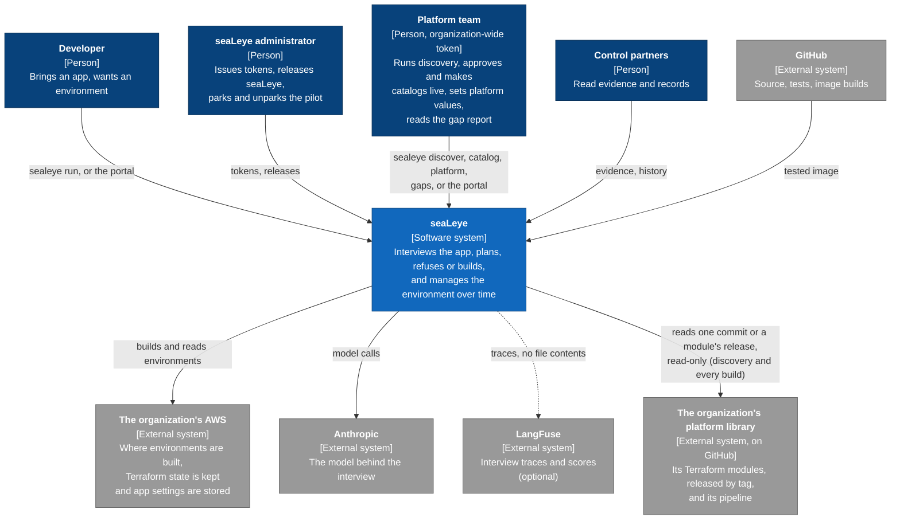

## 4. Containers (C4 level 2)

The deployable parts. Every arrow into the API is HTTPS with a token or the portal's
session cookie.

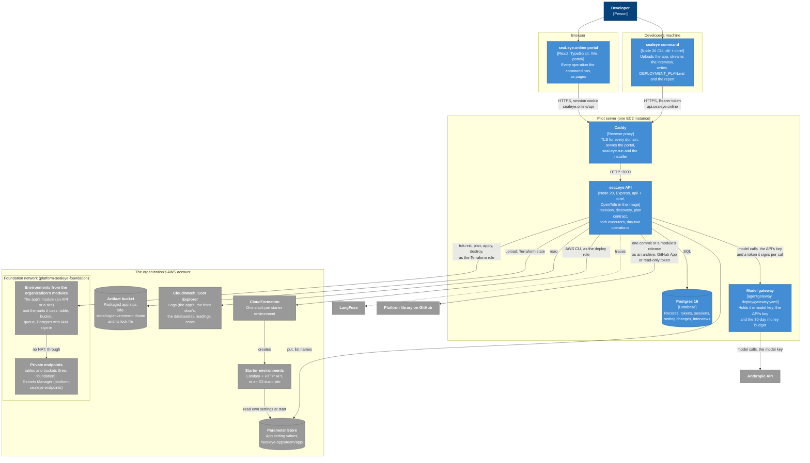

| Container | Code | Talks to | Notes |
|---|---|---|---|
| `sealeye` command | `cli/`, `core/` | the API only | Holds a token (`~/.sealeye/config`, 0600), never a model key or AWS credentials for deploying. Installed from seaLeye.run. |
| Portal | `portal/` | the API only, at `/api` on its own origin | Imports a few browser-safe `core/` files so both surfaces say the same words. Every value on a page comes from an API call. |
| Caddy | `deploy/Caddyfile` | the API, static files Certificates for sealeye.online, api.sealeye.online and sealeye.run (sealeye.org is GitHub Pages). Passes the interview's event stream through unbuffered. |
| API | `api/`, `core/`, `prompts/`, `templates/` | Postgres, AWS (CLI and OpenTofu), the model gateway, LangFuse, GitHub | The only part that reaches AWS: the AWS CLI as the deploy role for the starter's templates, `tofu` (pinned in the image, providers from the image only) as the Terraform role for an organization's modules. One process. On the server it holds a key for the gateway, not a model key; on a laptop, with no `SEALEYE_GATEWAY_KEY`, it calls Anthropic with its own key. |
| Model gateway | `deploy/gateway.yaml`, `deploy/gateway.sh` | Anthropic | agentgateway, pinned by digest. The only part on the server that holds the model key. Lets through only the API's key with a token the API signed for that call (person, team, run, worker, surface), and logs those names; keeps a money budget for each 30-day period and a record of every call (90 days, read by `deploy/server.sh gateway-calls`) in its own SQLite file, and a per-run token limit in memory; logs no prompts or replies. On a network of its own that only the API joins; no published port. |
| Postgres | `api/migrations/` | | Reachable only from the API, on the server's own network. |

## 5. Inside the API (C4 level 3)

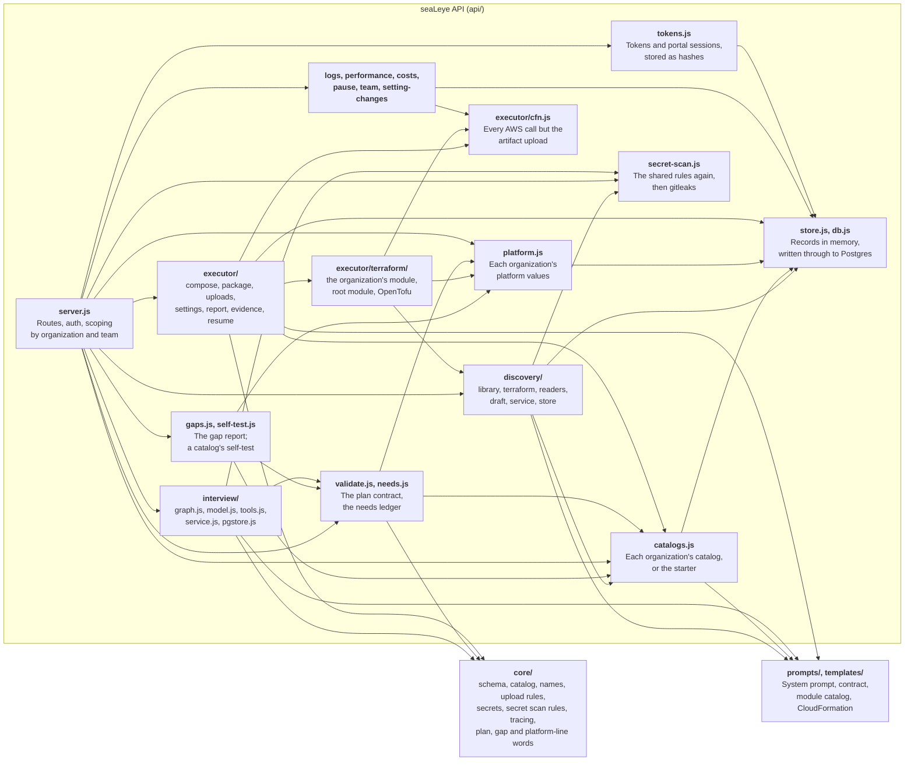

**The import boundary.** `cli/` and `api/` import from `core/` and never from each
other; `core/` imports only from `core/`; the portal may import a `core/` file only if it
runs in a browser. `test/boundaries.test.js` enforces it.

**The interview graph.** Each pause for the developer is a node of its own with no model
call before it, so resuming after a restart never repeats a model call.

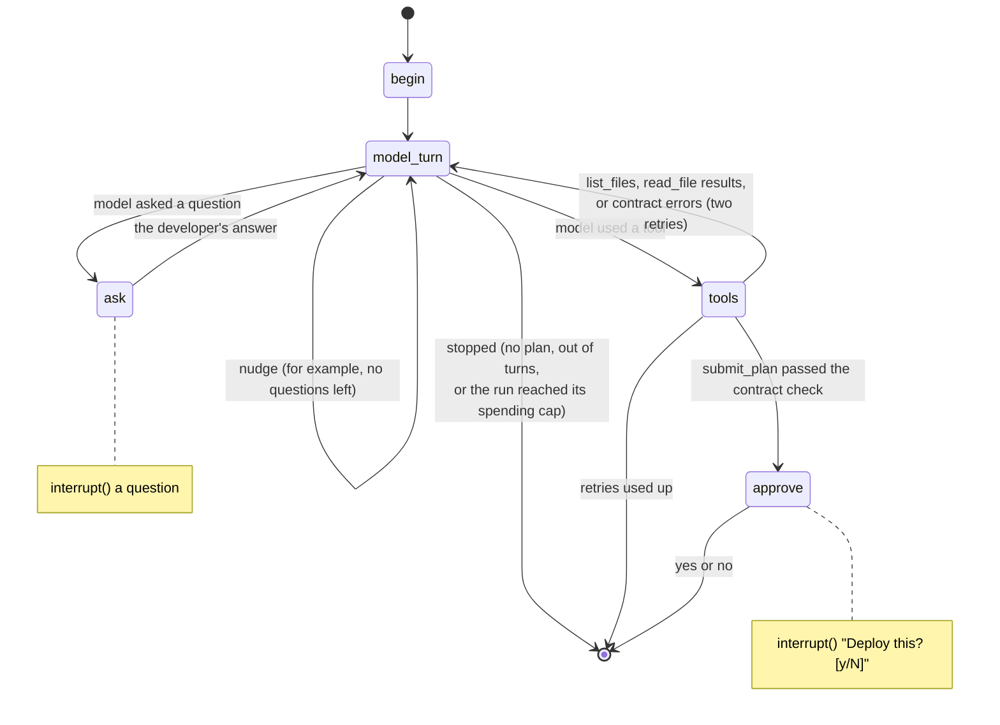

## 6. Deployment

What runs where, and how a change reaches production.

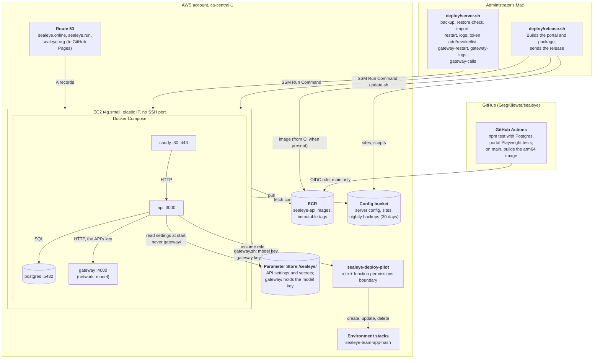

- **Platform stacks** are named `platform-sealeye-*` (server, deploy role, CI role, one
  DNS stack per domain). The deploy role cannot touch them.
- **The server's own role** can read its settings, pull its image, use its config
  bucket and assume a `sealeye-deploy-*` role. It cannot build anything itself.
- **The API's settings** come from Parameter Store under `/sealeye/` at start
  (`deploy/settings.mjs`), including LangFuse keys, the key it calls the model gateway
  with and the database password. The API then drops the database password from its
  own environment. The model key is under `/sealeye/gateway/`, which the API never
  reads; `deploy/gateway.sh` hands it to the gateway alone.
- **Releasing is manual.** GitHub tests every change and builds the image on main;
  `deploy/release.sh` uses that image and rolls it out. `deploy/README.md` has every
  server operation.
- **Backups** run nightly to the config bucket and are checked with
  `deploy/server.sh restore-check`.

## 7. Key flows

### 7.1 `sealeye run`: interview, plan, deploy

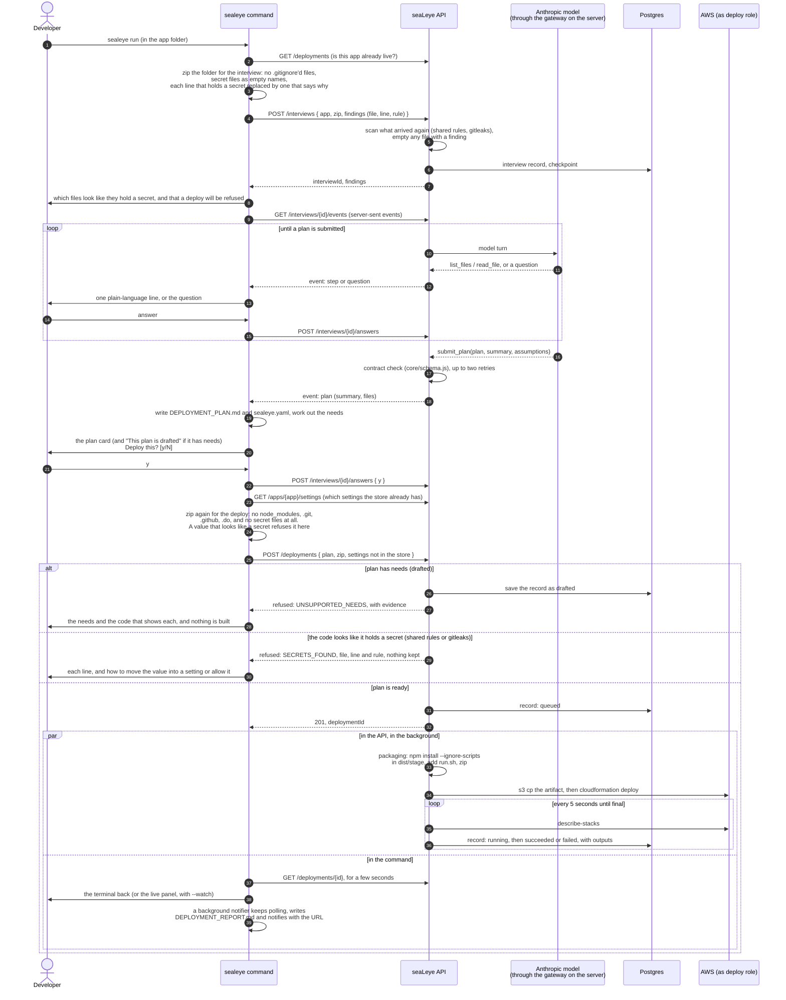

A static site follows the same path without the package: the stack makes the bucket and
the API copies the files into it before calling the deploy a success. On a re-run, the
first call finds the live environment, and the plan card is a difference against it.

The portal's New environment page runs the same flow from a folder chosen in the
browser, using the same upload rules (`core/upload-rules.js`). An interview started on
one surface can be finished on the other.

### 7.2 Portal sign-in

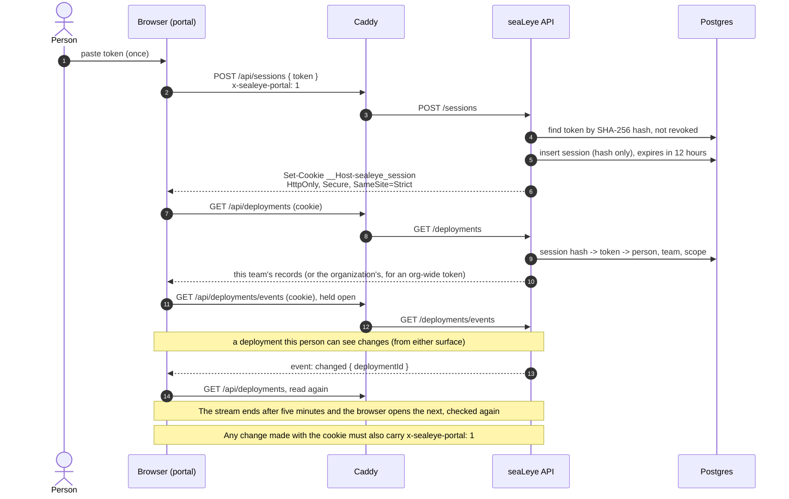

### 7.3 An app reads its settings when it starts

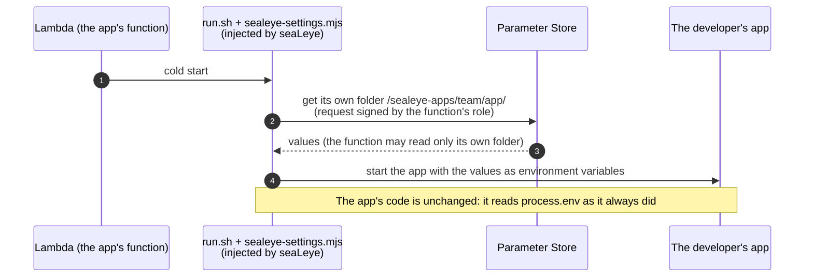

### 7.4 One model call

Every turn of an interview is one of these (PHASE3-PLAN Steps 3 to 7). On a laptop, with
no gateway key, the API calls Anthropic directly with its own key and steps 2 to 4 and
6 to 7 do not happen.

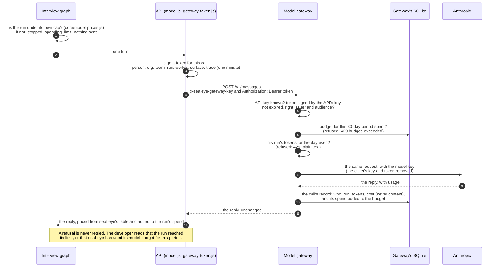

### 7.5 Release

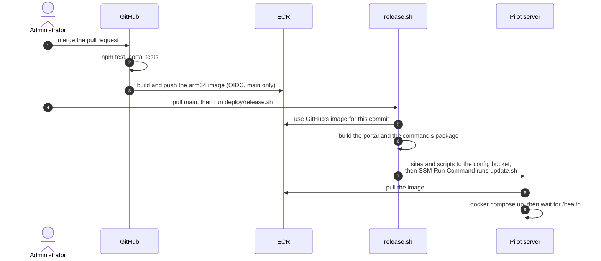

**The discovery run.** Plain code reads the library and lists its modules; the readers
run in parallel and never wait on a person; the supervisor writes the draft, with the
words a developer reads, the planner's guidance and which needs each module meets
(`meets`). A question goes out the moment a reader raises it, and an answer is used
whenever it comes: before the entries are written it is simply read, after, it re-writes
only what it touches. A run compares the library with the run behind the live catalog:
modules whose code is unchanged keep their finding and their entry as approved, with
their questions, so only what changed is read and written again (`--all` reads
everything; DESIGN.md, "Discovery reads again only what changed"). The live catalog then feeds the interview, the executor and the
gap report, which judges every drafted plan's needs against it.

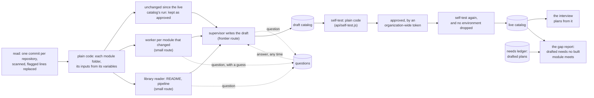

## 8. Data

### 8.1 Postgres

`api/migrations/` holds plain SQL applied in name order at start and recorded in
`schema_migrations`. The `interview_state` schema is made at every start instead,
because the nightly backup leaves it out (it holds interviews in progress, which include
the developer's code, and lives a day at most).

```mermaid
erDiagram
  TOKENS ||--o{ SESSIONS : "signs in as"
  TOKENS {
    text token_id PK
    text token_hash UK "SHA-256, never the token"
    text email
    text name
    text org_id
    text team_id
    text scope "team or org"
    timestamptz created_at
    timestamptz revoked_at
    timestamptz last_used_at
  }
  SESSIONS {
    text session_hash PK "SHA-256 of the cookie"
    text token_id FK
    timestamptz created_at
    timestamptz expires_at "12 hours"
  }
  DEPLOYMENTS {
    text deployment_id PK
    text org_id
    text team_id
    text created_by "the token's person"
    text surface "cli or portal"
    text trace_id
    text app
    text status
    timestamptz started_at
    timestamptz updated_at
    jsonb record "the whole record"
  }
  SETTING_CHANGES {
    bigserial id PK
    text org_id
    text team_id
    text app
    text name "never the value"
    text action "set or removed"
    text by_email
    text by_name
    text surface
    timestamptz at
  }
  CATALOGS {
    text org_id PK
    integer version PK
    text status "draft, approved, live or retired"
    jsonb document "modules, need kinds, profiles, patterns"
    text created_by
    timestamptz created_at
    text approved_by
    timestamptz approved_at
    text made_live_by
    timestamptz made_live_at
  }
  INTERVIEWS {
    text interview_id PK "schema interview_state"
    jsonb record
    timestamptz created_at
    timestamptz updated_at
  }
  INTERVIEW_EVENTS {
    text interview_id PK, FK
    integer seq PK
    jsonb event
  }
  INTERVIEWS ||--o{ INTERVIEW_EVENTS : "streams"
  DISCOVERIES {
    text id PK
    text org_id
    text status "running, finished, stopped or failed"
    jsonb record "commits read, each module's finding, the draft's version, spend"
    timestamptz created_at
    timestamptz updated_at
  }
  DISCOVERY_QUESTIONS {
    text id PK
    text discovery_id FK
    text org_id
    jsonb question "the question, its evidence, the guess, the answer and who gave it"
    timestamptz answered_at
    timestamptz created_at
  }
  DISCOVERIES ||--o{ DISCOVERY_QUESTIONS : "asks"
  PLATFORM_VALUES {
    text org_id PK
    text stage PK "dev, sit, uat, staging, perf or prod"
    text name PK "an input's name, or module.input"
    jsonb value "a word or a list of words: ids, never a secret"
    text set_by
    timestamptz set_at
  }
```

`PLATFORM_VALUES` holds what only an organization's platform team can give a Terraform
module (PHASE4-PLAN Step 9): read beside a catalog to say what it builds, never stored in
one. A Terraform environment's state is in S3, `tofu-state/<org>/<environment>.tfstate`
in the platform's bucket, with OpenTofu's lock file beside it.

`DEPLOYMENTS` and `SETTING_CHANGES` are joined to people through `org_id`, `team_id`
and the person's email, not by a foreign key, so a record outlives a revoked token.
`CATALOGS` holds each organization's catalogs (PHASE4-PLAN Step 1), one live at most;
an organization with none plans against the starter catalog,
`prompts/module-catalog.yaml`, which is not a row. A draft goes live in two steps, the
self-test at each (Step 7): approved, by whom and when, then made live, by whom and
when; a retired catalog may go live again. `DISCOVERIES` and
`DISCOVERY_QUESTIONS` hold each discovery run and what it asked (PHASE4-PLAN Step 6): a
finding is lines and evidence pointers (a file and what it shows), never a file's
contents; the draft a run writes is a `CATALOGS` row.
LangGraph's own checkpoint tables also live in `interview_state`.

### 8.2 Outside Postgres

| What | Where | Kept for |
|---|---|---|
| App setting values | Parameter Store, `/sealeye-apps/<team>/<app>/` | until unset; never copied into seaLeye |
| Packaged app zips | artifact bucket, `<name>/<deploymentId>.zip` | reused by Deploy again |
| Uploaded copies | `~/.sealeye/deploy-uploads/<deploymentId>/` on the server | until the deployment ends |
| Interview scratch folders | on the server | until the interview ends, or a day |
| Backups | config bucket, `backups/` | 30 days |
| Traces | LangFuse, when keys are set | LangFuse's retention (self-hosted from Phase 4) |
| The developer's files | the app folder: DEPLOYMENT_PLAN.md, sealeye.yaml, DEPLOYMENT_REPORT.md, DEPLOYMENT_EVIDENCE.md | the developer's |

### 8.3 The plan contract

planVersion 0.5, in `core/schema.js` (`contractSchema`). A plan names the catalog it
was written against (`catalog: starter`, or the version of one of the organization's
own that is or was live), and its module ids and need kinds are checked against that
catalog (`schemaFor` in `core/catalog.js`, `api/validate.js`). A module is buildable
when the catalog marks it available and the platform has an executor for what its
`builds_with` names: today CloudFormation, which builds the starter's four
(`static_site_edge`, `http_api_serverless`, `observability_basic`, `config_basic`).
Anything else an app needs is a NEED from that catalog's need kinds, or `unlisted`,
with evidence naming the file. A plan with needs is `drafted`; a plan without is
`ready`. 0.2, 0.3 and 0.4 plans are read as 0.5 against the starter. The interview plans
against the organization's live catalog from when it started: its model writes the 0.4
shape with that catalog's modules, and the platform stamps the plan 0.5 with the
catalog. A record keeps the plan's catalog, and a
deploy whose plan names a replaced catalog that no longer builds a module it uses is
refused (CATALOG_CHANGED).

## 9. Security model

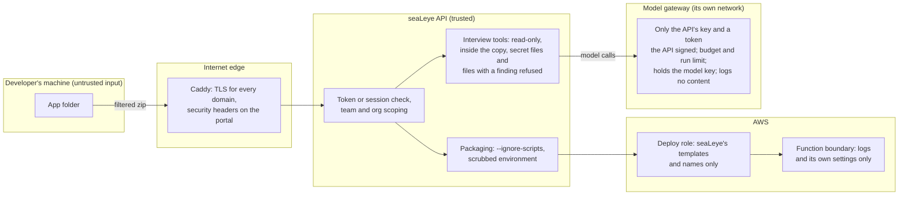

| Boundary | Control |
|---|---|
| The developer's folder to the API | Two uploads, one walk (`core/upload-rules.js`). For the interview: what `.gitignore` leaves out stays behind, and secret files (`core/secrets.js`) travel as empty names, as do archives and files that are not text, which no scanner sees into (the API empties any that arrive with contents). For the deploy: no `node_modules`, `.git`, `.github` or `.do`, and no secret file at all. Every file that travels is scanned for values that look like secrets (`core/scan.js`): for an interview, each such line travels as a line that says why (a private key, over many lines, sends its file as an empty name), and a deploy with one is refused, unless `.sealeye-allow` names the line. |
| What arrives at the API | Scanned again, because the client cannot be trusted: the shared rules and gitleaks (`api/secret-scan.js`), always with seaLeye's own configuration, so nothing in the folder can switch it off. An interview's flagged lines are replaced, or a file with a private key emptied, before the graph starts; a deploy with one is refused (`SECRETS_FOUND`) and nothing is kept. If gitleaks is installed and cannot finish, neither goes ahead (`SCAN_FAILED`). |
| A platform library to discovery | One commit of each named repository, fetched read-only from GitHub's API (`api/discovery/`) with a GitHub App's token narrowed to that repository and to reading it, or a read-only personal token; the credential goes to GitHub's API and nowhere else. Walked by the same rules as an upload (purpose `discovery`: `.github` is read, `.gitignore` followed, secret files as empty names), then scanned with the shared rules and gitleaks; each flagged line is replaced, a private key's file emptied, before any worker reads it. Archives and files that are not text, which neither scanner sees into, are kept as names only. A library's `.sealeye-allow` is not read and its `.gitleaksignore` is left out. An app's token is revoked once the archive is read. |
| The model reading the app | `list_files` and `read_file` are read-only, inside the copy and capped in size. `read_file` refuses secret files and files with a finding, and says which line and what kind; `list_files` shows only their names. LangSmith tracing stays off. |
| Callers to the API | One token per person, stored only as a hash, issued on the administrator's machine. The portal trades it for an HttpOnly, `SameSite=Strict`, `__Host-` cookie; changes also need `x-sealeye-portal: 1`. An API with a database cannot run with auth off. |
| Team to team | A record is its team's; an organization-wide token sees every team's; nobody sees another organization's. Each team's environments have names of their own. |
| The app's own code at build time | Dependencies install with `--ignore-scripts` and an environment holding only what npm needs. |
| The API to AWS | The server role can only assume `sealeye-deploy-*`. The deploy role builds only seaLeye's resources, and can create a function role only with the permissions boundary on it. |
| The built app at run time | The boundary allows logs and reading `/sealeye-apps/`; each function's role narrows that to its own folder. |
| Reading an organization's environment back | Through the Terraform role, whose log permissions are a managed policy of their own: its app logs, its front door's record and its database's own log and refused sign-ins (`logs:FilterLogEvents` on groups named `/aws/lambda/sealeye-*`, `/aws/vendedlogs/apigateway/sealeye-*` and `/aws/rds/instance/sealeye-*` only; the API asks only for the groups its modules named, believed only when named for the environment, `<name>-dev` then `-` or `/`, and never the database setup function's); a failed database setup step's last lines, from that environment's own function only, any line that looks like a secret replaced; and the detached network interfaces its functions left, deleted only when detached and named for its functions. A database's lines never show what the app sent it (a failed query, the values that broke a rule). |
| The front door's log delivery | `logs:CreateLogDelivery` and its relatives, with `logs:PutResourcePolicy`, on `*`, as AWS documents for an HTTP API's access log; the record goes under `/aws/vendedlogs/` so the account's log resource policy does not grow with each app; a module that writes that policy itself is not built. |
| Secrets in output | Setting values never appear in records, evidence, logs, the terminal or the portal; logs pass through the same masking traces do. |
| Traces | Shapes of turns, file paths and sizes; never file contents. Off without LangFuse keys, or with `--no-trace`. |
| The API to the model | On the server the API holds no model key: the model key is the gateway's alone (`/sealeye/gateway/`, which the API never reads). The gateway lets through only the API's key with a token the API signed for that call, checked against the public half only. It is on a network only the API joins, with no published port. |
| Spending | Each run stops at its own cap (a dollar by default); the gateway refuses once its budget for the period is spent, and refuses a run past its daily token limit. Every refusal is told in plain words and never retried. |
| The gateway's log and record | Who, which run, tokens, cost and status; never a prompt, a reply, a token or a key (principle 11 in CLAUDE.md). The record keeps 90 days. |

Open security decisions are in [OPEN-QUESTIONS.md](OPEN-QUESTIONS.md): Q16
(identity-provider sign-in replacing tokens). Where an organization's traces live was
Q13, answered Oct 13, 2026: LangFuse self-hosted in ca-central-1, in ROADMAP Phase 4.

## 10. Cross-cutting concerns

- **Parity.** Each operation is an endpoint, a command and a page with one name. The
  table is in [ROADMAP.md](ROADMAP.md#parity-backlog).
- **Plain language.** Developers see no product names or one cloud's own nouns, no
  acronym left unspelled, no em dashes and no capacity numbers (`core/developer-words.js`).
  Shared wording lives in `core/plan-words.js`, `core/evidence-summary.js` and
  `core/plan-report-words.js`.
- **Status is real.** A record moves through queued, packaging, running, then succeeded
  or failed, mirroring the stack, and destroying then destroyed on tear down; a refused
  plan is drafted. Pause state, logs, readings and costs are read from AWS when asked.
- **Restarts.** At start the API picks up deployments still in flight
  (`api/executor/resume.js`) and interviews still open, from Postgres.
- **On a laptop.** With no `DATABASE_URL` the API keeps records in a JSON file and
  interviews in memory, and may run with `SEALEYE_AUTH=off`; a hosted API never can.
  `sealeye doctor` checks what the machine needs.
- **Spending.** A run is capped in seaLeye's graph, priced from `core/model-prices.js`;
  the gateway's budget and per-run limit are the outer limit. Both are close, not exact
  (DESIGN.md, "A run's cap is close, not exact").
- **Observability.** An interview is one LangFuse trace across its pauses, joined to the
  deployment and scored from fixed names in `core/tracing.js`. The gateway's log and
  `deploy/server.sh gateway-calls` name each model call's person, team and run, with the
  trace's id. `npm run eval:interview`
  grades the interview on the sample apps before and after any prompt change.
- **Testing.** `npm test` needs no AWS and no model; Postgres tests run when
  `SEALEYE_TEST_DATABASE_URL` is set. The portal has Playwright tests against the real
  API with sample records. GitHub runs both on every push and pull request.
- **Naming.** `sealeye-<team>-<app>-<hash>` for every environment resource,
  `platform-sealeye-*` for seaLeye's own.

## 11. Decision index

The decisions that shaped the architecture, by DESIGN.md heading.

| Area | DESIGN.md heading |
|---|---|
| Hosting | One small server in ca-central-1; Each domain has one job |
| The interview | The interview runs as a LangGraph graph; The interview runs in the API; The model's address is a setting; The interview reads the organization's catalog |
| Uploads and packaging | Deployments package an uploaded copy; One walk decides what travels, from the command and from the browser; The interview never reads secret files; Installing an app's dependencies runs none of its code; Secret files never go into the package |
| Data | Deployment records live in Postgres; The catalog is data, and every organization starts with the starter; A plan names its catalog (planVersion 0.5) |
| Identity | Every caller has a token, until sign-in; The portal signs in with a session cookie; Each team sees its own environments; Each team's environments have names of their own |
| Settings | Setting values travel with the deploy, for now; Settings live in the organization's store |
| Portal | The portal is a client of the API; The portal shares words with the command through core/ |
| Day two | Deploying again; An interview can be finished on the other surface; Pause and resume; Performance shows readings, not capacity; Configure is a deploy of the same code again; Logs pass through the masking traces do; Costs come from tags, a day behind |
| Delivery | GitHub tests every change and builds the image; A changed command is a new version |
| Tracing | Tracing the interview with LangFuse; Tracing stays in the product |
| Secrets in code | The secret scanner; The interview reads around a secret, not past the file |
| Spending | A run's cap is close, not exact; What a run costs, and a cap of a dollar; The cap on every run; The gateway's budget: $20 a period; The outer limit, and a record of calls kept 90 days |
| Learning the platform | Phase 4's decisions, and one reopened; The catalog is data, and every organization starts with the starter; A plan names its catalog (planVersion 0.5); The interview reads the organization's catalog; A module's name is found as code when it is an ordinary word; The made-up organization: Juniper Mutual; Discovery records which needs each module meets; The gap report; Discovery reads again only what changed |
| Building from the organization's modules | A Terraform executor builds an organization's own modules; Each module is built at the version its library released; Modules are connected through what the library offers; An app reaches a database in the private network; A tear-down waits for the private network, and sweeps what it leaves |
| What a developer sees of the platform | Logs are found by the command, never by a path; A Terraform environment's logs are read where its module says they are; What the platform saw, in the developer's words; The front door's and the database's lines, beside the app's; A failed setup step says its last lines |
| The model gateway | Phase 3's decisions, as recommended; agentgateway, read and run (Step 4); The model gateway on the server; A token on every model call; Inference from Canada: disclosed, on the US profile |

## 12. Known limits and where they go next

| Limit today | Why it is acceptable now | What changes it |
|---|---|---|
| One API process; the store reads from memory | One pilot server | Staged hosting (PHASE2-PLAN, "Owed after this plan"): a managed database, then containers when downtime matters |
| One shared AWS account and deploy role | The pilot is one organization | Phase 5: a role per team, in the team's account |
| Tokens instead of sign-in | A handful of people | Phase 5: Cognito (Q16) |
| An organization's environment is built at the dev stage, from one module that runs the app and the modules it uses, with no settings of its own | Developers deploy to dev; settings would be kept in plain text in state | Phase 5 for later stages; ROADMAP Phase 1 item 10 for settings |
| A module that only runs beside something else (a service that runs continuously, an internal front door) is not built | The executor builds what takes an app's code or offers it access | Each in its own step, as a gap report asks for them |
| Which needs a module meets is the model's judgment, fixed only by discovering again | A wrong one costs a wrong line in the gap report, never a build (Greg, Oct 22) | When a platform team needs to correct one by hand |
| ca-central-1, Node 20, no CloudFront from seaLeye's own templates | The pilot's scope | Phase 7 |
| Traces in LangFuse Cloud (US) | Sample apps and a made-up organization only; off for any pilot on real code | Self-hosted in ca-central-1, owed before the first customer's real code (ROADMAP Phase 4, PHASE4-PLAN "Owed after this plan") |
| No promotion past dev | Developers deploy to dev | Phase 5 |
| The gateway's own span is not in a run's trace | Traces are on LangFuse Cloud, which the gateway holds no keys to | With LangFuse in Canada (owed before the first customer's real code) |
| The interview and discovery send code to the Anthropic API, in the US, through the gateway | Sample apps, a made-up organization and public libraries | The Bedrock route, when the account has model access (Phase 3 Step 8, owed); disclosed, not kept in Canada (DESIGN.md, "Inference from Canada") |
