# seaLeye: architecture

First written Oct 12, 2026, at 2.20.0 (main at PR #31). This file describes the system
as it is built today. Why each part is the way it is lives in [DESIGN.md](../DESIGN.md);
where it is going lives in [VISION.md](VISION.md) and [ROADMAP.md](ROADMAP.md). When a
change makes a diagram here wrong, fix the diagram in the same commit.

The diagrams are Mermaid, so GitHub draws them and a change to one is a change to text.
The C4 views are drawn as Mermaid flowcharts in the C4 style rather than with Mermaid's
own C4 syntax, which GitHub still draws poorly.

## Contents

1. [The system in one paragraph](#1-the-system-in-one-paragraph)
2. [Goals and constraints](#2-goals-and-constraints)
3. [Context (C4 level 1)](#3-context-c4-level-1)
4. [Containers (C4 level 2)](#4-containers-c4-level-2)
5. [Inside the API (C4 level 3)](#5-inside-the-api-c4-level-3)
6. [Deployment](#6-deployment)
7. [Key flows](#7-key-flows)
8. [Data](#8-data)
9. [Security model](#9-security-model)
10. [Cross-cutting concerns](#10-cross-cutting-concerns)
11. [Decision index](#11-decision-index)
12. [Known limits and where they go next](#12-known-limits-and-where-they-go-next)

## 1. The system in one paragraph

A developer brings an app. The `sealeye` command (seaLeye.run) or the web portal
(seaLeye.online) uploads a filtered copy of it to the seaLeye API. The API runs an
interview, a LangGraph graph around a Claude model, that reads the copy, asks the
developer at most four questions and submits a plan. The API checks the plan against the
plan contract: a plan whose app needs something the platform cannot build is saved as a
draft and refused, with evidence; a ready plan, once the developer says yes, is
packaged and built from one of the platform's CloudFormation templates through a deploy
role that can build nothing else. The API keeps the record, mirrors the real stack
status, and serves every day-two operation (settings, logs, performance, costs, pause,
evidence, tear down) to both surfaces through the same endpoints.

## 2. Goals and constraints

| Goal | What it means for the architecture |
|---|---|
| **Parity** | One API; the command and the portal are thin clients of it. An operation is an endpoint first. |
| **Only the certified platform** | The API builds only from `templates/`, through a role scoped to seaLeye's names and a permissions boundary on every function. |
| **Refuse, never shrink** | The plan contract (`core/schema.js`) decides ready or drafted; the API refuses drafted plans itself, whatever the client says. |
| **Real status** | A deployment's status mirrors its stack, polled by the API every few seconds; pause state, logs, readings and costs are read from AWS when asked. Nothing is assumed. |
| **No secrets anywhere** | Secret files never leave the developer's machine with contents; setting values go to the organization's store and are never kept, logged or shown. |
| **The developer's code is theirs** | The app is never changed. What the platform needs is injected into the packaged copy. |
| **Cheap to run and to change** | One small server, plain SQL migrations, the AWS CLI instead of an SDK, tests that need no AWS and no model. |

Constraints today: one cloud (AWS), one region (ca-central-1), one backend
(CloudFormation), one runtime (Node 20), one API process.

## 3. Context (C4 level 1)

Who uses seaLeye and what it depends on.

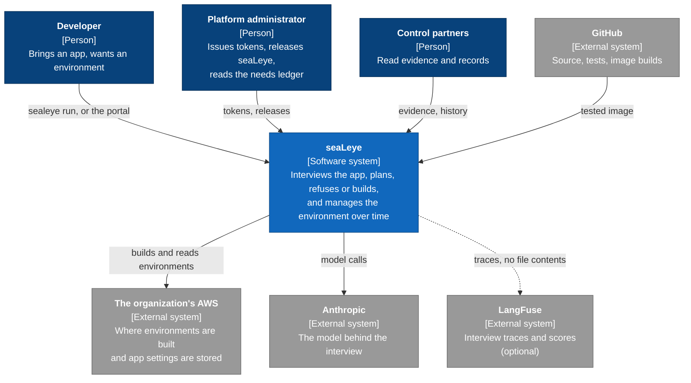

## 4. Containers (C4 level 2)

The deployable parts. Every arrow into the API is HTTPS with a token or the portal's
session cookie.

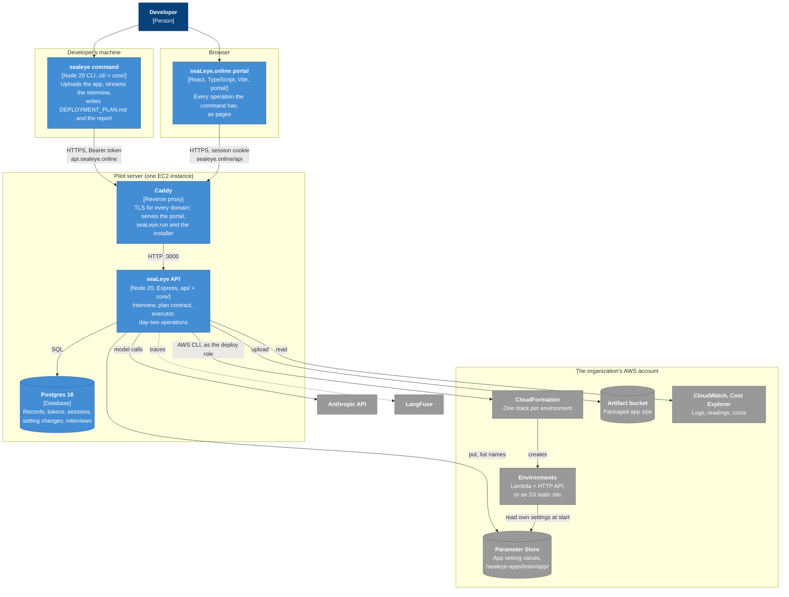

| Container | Code | Talks to | Notes |
|---|---|---|---|
| `sealeye` command | `cli/`, `core/` | the API only | Holds a token (`~/.sealeye/config`, 0600), never a model key or AWS credentials for deploying. Installed from seaLeye.run. |
| Portal | `portal/` | the API only, at `/api` on its own origin | Imports a few browser-safe `core/` files so both surfaces say the same words. Every value on a page comes from an API call. |
| Caddy | `deploy/Caddyfile` | the API, static files | Certificates for sealeye.online, api.sealeye.online, sealeye.run, sealeye.org. Passes the interview's event stream through unbuffered. |
| API | `api/`, `core/`, `prompts/`, `templates/` | Postgres, AWS (CLI), Anthropic, LangFuse | The only part that holds a model key or reaches AWS. One process. |
| Postgres | `api/migrations/` | | Reachable only from the API, on the server's own network. |

## 5. Inside the API (C4 level 3)

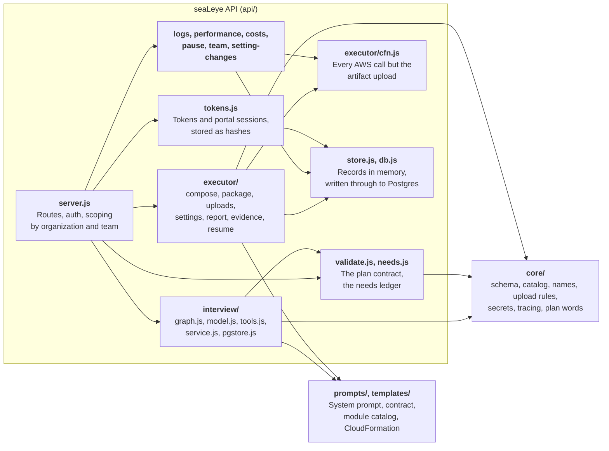

**The import boundary.** `cli/` and `api/` import from `core/` and never from each
other; `core/` imports only from `core/`; the portal may import a `core/` file only if it
runs in a browser. `test/boundaries.test.js` enforces it.

**The interview graph.** Each pause for the developer is a node of its own with no model
call before it, so resuming after a restart never repeats a model call.

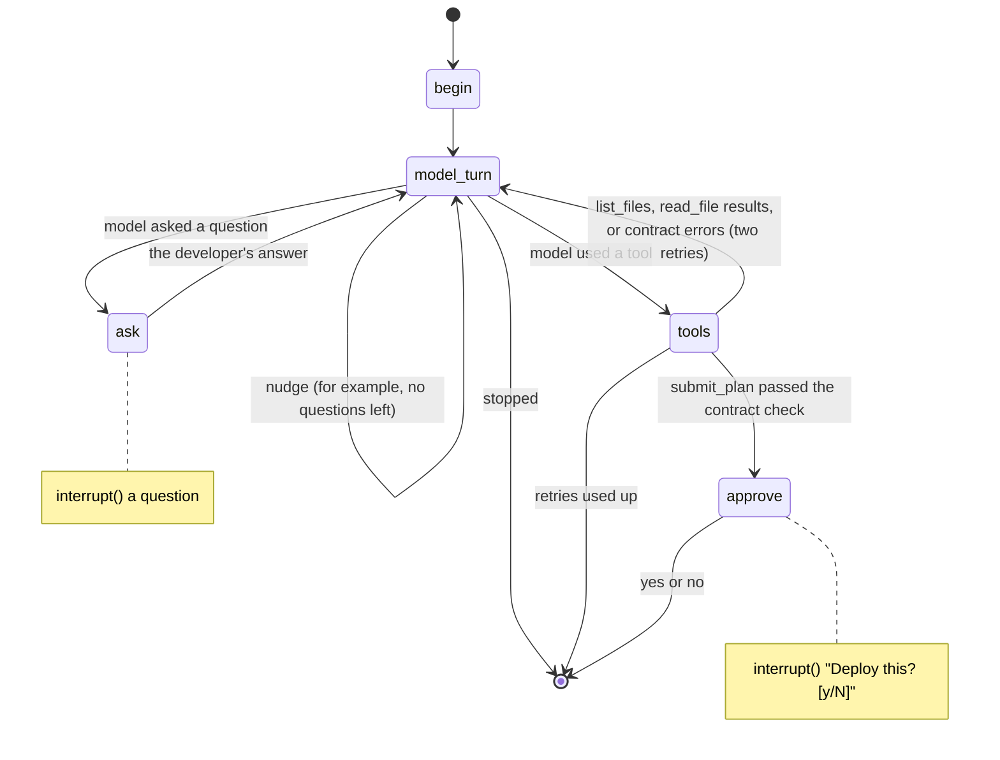

## 6. Deployment

What runs where, and how a change reaches production.

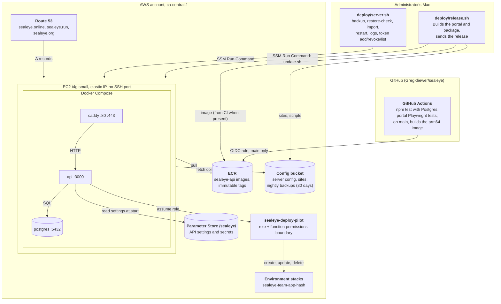

- **Platform stacks** are named `platform-sealeye-*` (server, deploy role, CI role, one
  DNS stack per domain). The deploy role cannot touch them.
- **The server's own role** can read its settings, pull its image, use its config
  bucket and assume a `sealeye-deploy-*` role. It cannot build anything itself.
- **The API's settings** come from Parameter Store under `/sealeye/` at start
  (`deploy/settings.mjs`), including the model key, LangFuse keys and the database
  password. The API then drops the database password from its own environment.
- **Releasing is manual.** GitHub tests every change and builds the image on main;
  `deploy/release.sh` uses that image and rolls it out. `deploy/README.md` has every
  server operation.
- **Backups** run nightly to the config bucket and are checked with
  `deploy/server.sh restore-check`.

## 7. Key flows

### 7.1 `sealeye run`: interview, plan, deploy

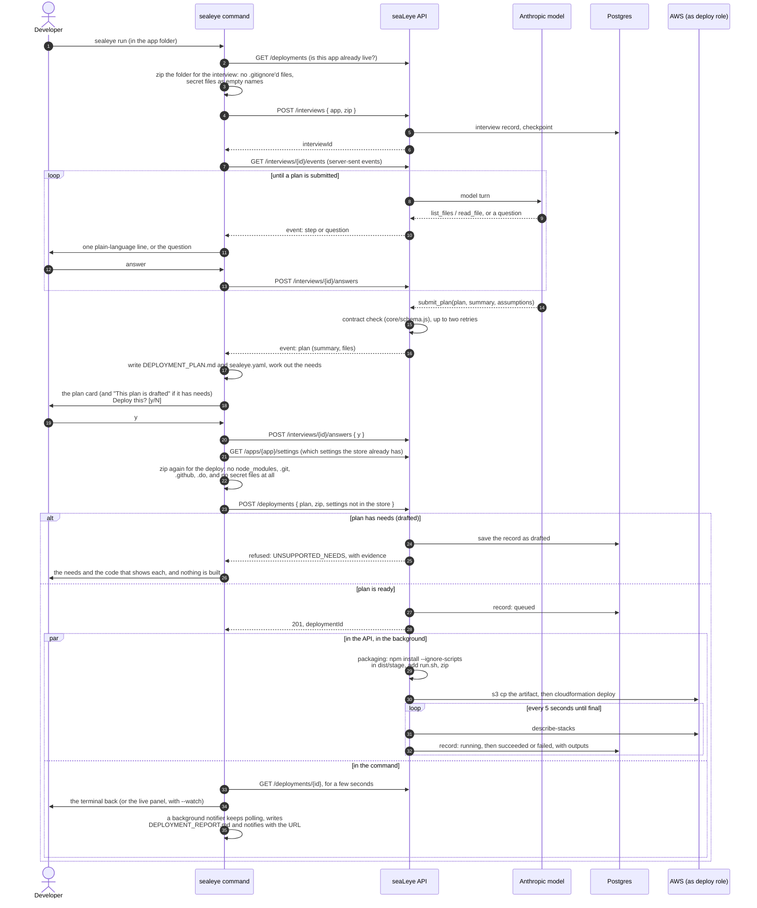

A static site follows the same path without the package: the stack makes the bucket and
the API copies the files into it before calling the deploy a success. On a re-run, the
first call finds the live environment, and the plan card is a difference against it.

The portal's New environment page runs the same flow from a folder chosen in the
browser, using the same upload rules (`core/upload-rules.js`). An interview started on
one surface can be finished on the other.

### 7.2 Portal sign-in

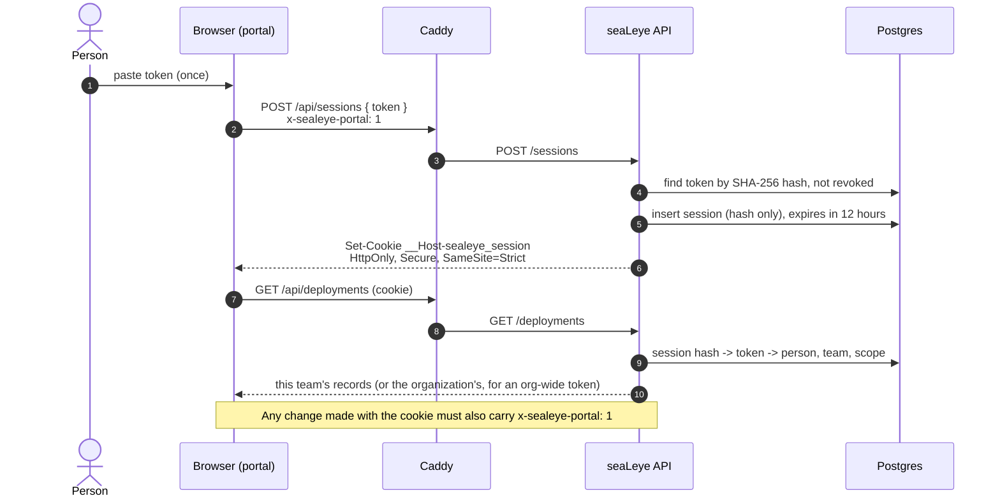

### 7.3 An app reads its settings when it starts

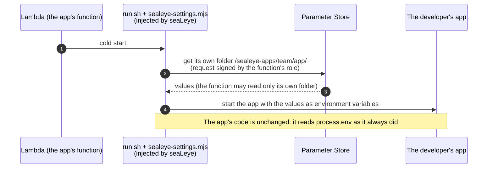

### 7.4 Release

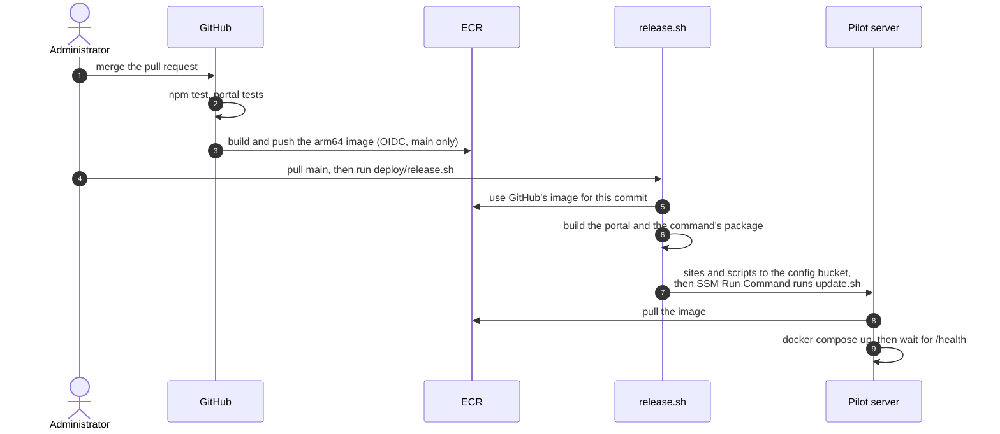

## 8. Data

### 8.1 Postgres

`api/migrations/` holds plain SQL applied in name order at start and recorded in
`schema_migrations`. The `interview_state` schema is made at every start instead,
because the nightly backup leaves it out (it holds interviews in progress, which include
the developer's code, and lives a day at most).

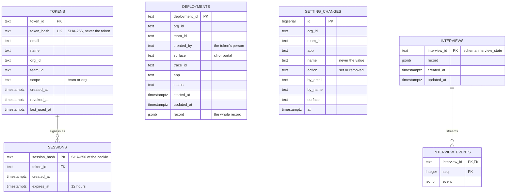

`DEPLOYMENTS` and `SETTING_CHANGES` are joined to people through `org_id`, `team_id`
and the person's email, not by a foreign key, so a record outlives a revoked token.
LangGraph's own checkpoint tables also live in `interview_state`.

### 8.2 Outside Postgres

| What | Where | Kept for |
|---|---|---|
| App setting values | Parameter Store, `/sealeye-apps/<team>/<app>/` | until unset; never copied into seaLeye |
| Packaged app zips | artifact bucket, `<name>/<deploymentId>.zip` | reused by Deploy again |
| Uploaded copies | `~/.sealeye/deploy-uploads/<deploymentId>/` on the server | until the deployment ends |
| Interview scratch folders | on the server | until the interview ends, or a day |
| Backups | config bucket, `backups/` | 30 days |
| Traces | LangFuse, when keys are set | LangFuse's retention (self-hosted from Phase 4) |
| The developer's files | the app folder: DEPLOYMENT_PLAN.md, sealeye.yaml, DEPLOYMENT_REPORT.md, DEPLOYMENT_EVIDENCE.md | the developer's |

### 8.3 The plan contract

planVersion 0.4, in `core/schema.js` and `prompts/plan-contract.yaml`. Four buildable
modules: `static_site_edge`, `http_api_serverless`, `observability_basic`,
`config_basic`. Anything else an app needs is a NEED from the fixed list in
`prompts/module-catalog.yaml`, with evidence naming the file. A plan with needs is
`drafted`; a plan without is `ready`.

## 9. Security model

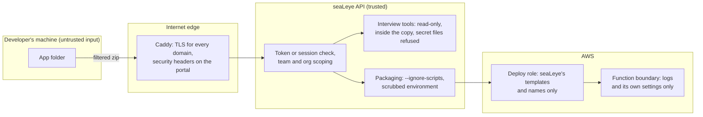

| Boundary | Control |
|---|---|
| The developer's folder to the API | Two uploads, one walk (`core/upload-rules.js`). For the interview: what `.gitignore` leaves out stays behind, and secret files (`core/secrets.js`) travel as empty names. For the deploy: no `node_modules`, `.git`, `.github` or `.do`, and no secret file at all. |
| The model reading the app | `list_files` and `read_file` are read-only, inside the copy and capped in size. `read_file` refuses secret files; `list_files` shows only their names. LangSmith tracing stays off. |
| Callers to the API | One token per person, stored only as a hash, issued on the administrator's machine. The portal trades it for an HttpOnly, `SameSite=Strict`, `__Host-` cookie; changes also need `x-sealeye-portal: 1`. An API with a database cannot run with auth off. |
| Team to team | A record is its team's; an organization-wide token sees every team's; nobody sees another organization's. Each team's environments have names of their own. |
| The app's own code at build time | Dependencies install with `--ignore-scripts` and an environment holding only what npm needs. |
| The API to AWS | The server role can only assume `sealeye-deploy-*`. The deploy role builds only seaLeye's resources, and can create a function role only with the permissions boundary on it. |
| The built app at run time | The boundary allows logs and reading `/sealeye-apps/`; each function's role narrows that to its own folder. |
| Secrets in output | Setting values never appear in records, evidence, logs, the terminal or the portal; logs pass through the same masking traces do. |
| Traces | Shapes of turns, file paths and sizes; never file contents. Off without LangFuse keys, or with `--no-trace`. |

Open security decisions are in [OPEN-QUESTIONS.md](OPEN-QUESTIONS.md): Q16
(identity-provider sign-in replacing tokens). Where an organization's traces live was
Q13, answered Oct 13, 2026: LangFuse self-hosted in ca-central-1, in ROADMAP Phase 4.

## 10. Cross-cutting concerns

- **Parity.** Each operation is an endpoint, a command and a page with one name. The
  table is in [ROADMAP.md](ROADMAP.md#parity-backlog).
- **Plain language.** Developers see no AWS terms, no em dashes and no capacity numbers.
  Shared wording lives in `core/plan-words.js` and `core/evidence-summary.js`.
- **Status is real.** A record moves through queued, packaging, running, then succeeded
  or failed, mirroring the stack, and destroying then destroyed on tear down; a refused
  plan is drafted. Pause state, logs, readings and costs are read from AWS when asked.
- **Restarts.** At start the API picks up deployments still in flight
  (`api/executor/resume.js`) and interviews still open, from Postgres.
- **On a laptop.** With no `DATABASE_URL` the API keeps records in a JSON file and
  interviews in memory, and may run with `SEALEYE_AUTH=off`; a hosted API never can.
  `sealeye doctor` checks what the machine needs.
- **Observability.** An interview is one LangFuse trace across its pauses, joined to the
  deployment and scored from fixed names in `core/tracing.js`. `npm run eval:interview`
  grades the interview on the sample apps before and after any prompt change.
- **Testing.** `npm test` needs no AWS and no model; Postgres tests run when
  `SEALEYE_TEST_DATABASE_URL` is set. The portal has Playwright tests against the real
  API with sample records. GitHub runs both on every push and pull request.
- **Naming.** `sealeye-<team>-<app>-<hash>` for every environment resource,
  `platform-sealeye-*` for seaLeye's own.

## 11. Decision index

The decisions that shaped the architecture, by DESIGN.md heading.

| Area | DESIGN.md heading |
|---|---|
| Hosting | One small server in ca-central-1; Each domain has one job |
| The interview | The interview runs as a LangGraph graph; The interview runs in the API; The model's address is a setting |
| Uploads and packaging | Deployments package an uploaded copy; One walk decides what travels, from the command and from the browser; The interview never reads secret files; Installing an app's dependencies runs none of its code; Secret files never go into the package |
| Data | Deployment records live in Postgres |
| Identity | Every caller has a token, until sign-in; The portal signs in with a session cookie; Each team sees its own environments; Each team's environments have names of their own |
| Settings | Setting values travel with the deploy, for now; Settings live in the organization's store |
| Portal | The portal is a client of the API; The portal shares words with the command through core/ |
| Day two | Deploying again; An interview can be finished on the other surface; Pause and resume; Performance shows readings, not capacity; Configure is a deploy of the same code again; Logs pass through the masking traces do; Costs come from tags, a day behind |
| Delivery | GitHub tests every change and builds the image; A changed command is a new version |
| Tracing | Tracing the interview with LangFuse; Tracing stays in the product |

## 12. Known limits and where they go next

| Limit today | Why it is acceptable now | What changes it |
|---|---|---|
| One API process; the store reads from memory | One pilot server | Staged hosting (PHASE2-PLAN, "Owed after this plan"): a managed database, then containers when downtime matters |
| One shared AWS account and deploy role | The pilot is one organization | Phase 5: a role per team, in the team's account |
| Tokens instead of sign-in | A handful of people | Phase 5: Cognito (Q16) |
| Four modules, CloudFormation only | The demo platform | Phase 4: the organization's own modules, Terraform |
| ca-central-1, Node 20, no CloudFront | The pilot's scope | Phase 7 |
| Traces in LangFuse Cloud (US) | Sample apps only; off for any pilot on real code | Phase 4: self-hosted in ca-central-1, before discovery reads an organization's code |
| No promotion past dev | Developers deploy to dev | Phase 5 |
| No gateway in front of the model | One agent, one box | Phase 3: agentgateway, routing and spend caps |
| The interview sends an app's code to the Anthropic API, in the US | Sample apps and a friendly team | Phase 3: a route to Claude on Bedrock in the organization's account; whether it stays in Canada is Q18 |
| A key written into code (not a secret file) can reach the model | Sample apps and a friendly team | Phase 3: a secret scanner before any model (Q6) |
