# seaLeye: the build-out, phase by phase

First written Tue Oct 13, 2026, at 2.21.0. One picture per phase of [ROADMAP.md](ROADMAP.md),
all on the same layout, so a reader can flip between them and see what each phase adds,
and under it the one flow that shows the phase at work. Parts new or changed in a phase
are drawn in blue. [ARCHITECTURE.md](ARCHITECTURE.md)
describes the system as built today; this file describes where it is going. Why each
change is made lives in [DESIGN.md](../DESIGN.md), "The roadmap gains a governed backbone
and a door for agents".

When ROADMAP.md changes what a phase holds, fix its picture here in the same commit.

## The phases at a glance

| Phase | Name | State | What it adds |
|---|---|---|---|
| 0 | Foundation | Done Oct 8, 2026 | The demo becomes a product repo: cli, api and core, tests, CLAUDE.md, the roadmap |
| 1 | Team release | Mostly done Oct 11, 2026 | Hosted API, tokens, Postgres, the live portal, CI. Open: the second-person test, paused by Greg (PHASE2-PLAN Step 6), and the store for settings in an environment built from the organization's own modules (item 10) |
| 2 | Day-two parity | Built Oct 12, 2026 | Logs, performance, costs, pause, configure, the settings store and evidence, on both surfaces |
| 3 | Governed backbone | Built Oct 14, 2026; routing by task (`small`, `frontier`) Oct 15 ([PHASE3-PLAN.md](PHASE3-PLAN.md), PHASE4-PLAN Step 5) | agentgateway in front of every model call, identity per caller, spend caps, the secret scanner. Open: routing by data class and the Bedrock route. The gateway's span in the trace waits for LangFuse in Canada |
| 4 | Learn the platform | Built Oct 22, 2026, all but what runs in a customer's account ([PHASE4-PLAN.md](PHASE4-PLAN.md)) | A discovery swarm reads the organization's library into its catalog, with a self-test before it goes live; the Terraform executor (OpenTofu, at each module's released version) builds an app's module and the modules it uses, connected, a database in the private network among them; logs from the app, the front door and the database; a gap report; a run reads again only what changed. Open: LangFuse self-hosted in Canada, discovery in a customer's own account, and the Bedrock route (all before the first customer) |
| 5 | The path to production | Planned in [PHASE5-PLAN.md](PHASE5-PLAN.md) (Oct 22, 2026; rewritten Oct 24 for every stage), decisions waiting on Greg; nothing built | Promote, approvals in ServiceNow, every later stage built and managed by seaLeye (5a) or by the organization's pipeline, which seaLeye drives (5b), a role per stage, Jira gap tickets with options and a recommendation; team accounts and Cognito sign-in planned |
| 6 | seaLeye for agents | **New**, planned | seaLeye's tools as MCP behind the gateway, for coding agents |
| 7 | Delivery and breadth | Planned | In-network or single tenant, the organization's own model, more clouds and regions, Windows |
| 8 | seaLeye drafts modules | **New**, last | A chosen gap arrives as a module in a pull request to the platform team; seaLeye never merges it |

Phases 3, 6 and 8 were added on Oct 13, 2026; the old Phases 3, 4 and 5 became 4, 5 and 7.

## Phases 0 to 2, as built (v2.21.0)

At v2.21.0 (Oct 13, 2026) one agent built only from four certified templates. Phases 0 to 2 were built Sept 20 to Oct 12, 2026. The system today, v2.50.0, is Phase 4's picture on Phase 3's backbone; [ARCHITECTURE.md](ARCHITECTURE.md) draws it in full. One agent, one model, every run traced.

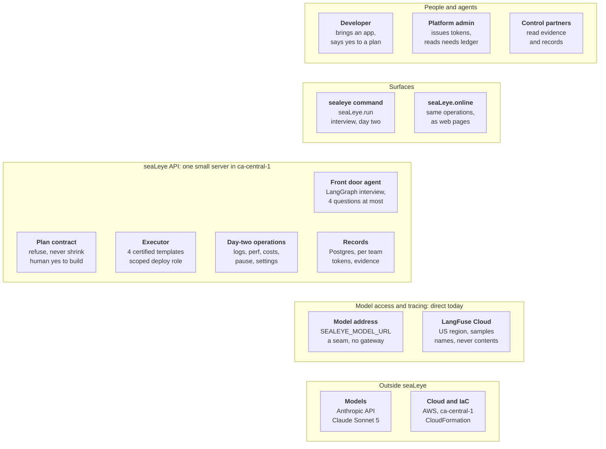

Key flow at v2.21.0: one `sealeye run`. A plan with needs is refused; only a ready plan is built. Every step is traced in LangFuse, file names but never contents.

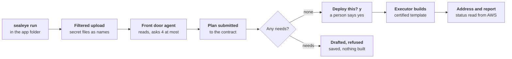

## Phase 3: Governed backbone

Phase 3 puts one governed door in front of every model call, and a secret scanner in front of the model. Built before discovery, so the swarm runs on both from day one. The second-person test (Phase 1) can run alongside it.

**Built Oct 14, 2026** (green below): the secret scanner, each run's cap, and agentgateway on the server. The gateway holds the model key, checks a token the API signs for each call, writes its person, team and run into its log and its record of calls, and holds the $20 budget and a per-run limit. **Built since** (Oct 15, PHASE4-PLAN Step 5): routing by task, the named routes `small` and `frontier`. **Still to come** (blue): routing by data class and the Bedrock route (waiting on the account's model access). The gateway's own span in the run's trace moved to Phase 4, with self-hosted LangFuse; until then each gateway line carries the run's trace id.

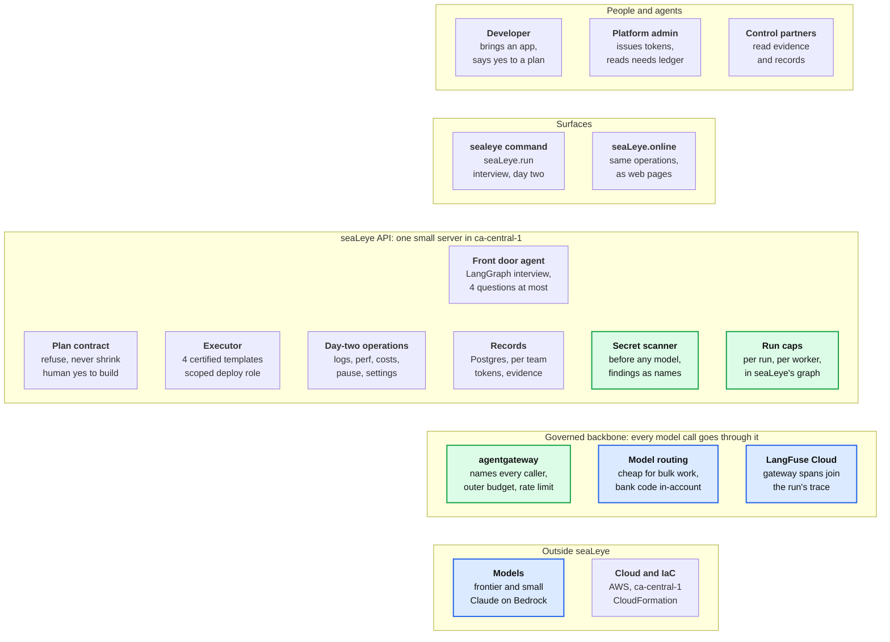

Key flow: one model call through the backbone. Nothing with a secret in it is sent. seaLeye stops a run at its own cap; the gateway names the caller, holds the outer budget and routes the call.

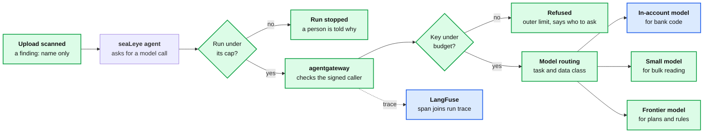

## Phase 4: Learn the platform

Phase 4 teaches seaLeye the platform the organization already has. A discovery swarm reads the library overnight, in a new account opened for that customer, not on seaLeye's own server; the front door agent then works from the catalog it writes.

**Built Oct 22, 2026** (green below): discovery reads the library, asks its questions without ever waiting and writes a draft that a self-test checks before an organization-wide token approves it and makes it live; the interview plans from that catalog; the Terraform executor builds the organization's own modules with OpenTofu, through its own deploy role, at the version its library released (an app's module, and a table, a bucket, a queue or a database connected to it), reads their logs back (the app's, the front door's and the
database's, in one stream, in the developer's words), and tears them down; a platform engineer gives modules the organization's platform values; the private network's paid endpoints are removed between bursts by `deploy/server.sh park`; a run reads again only what changed since the live catalog; the gap report says what developers asked for that the catalog cannot build. All of it was proven on the pilot with the made-up Juniper Mutual. **Still to come** (blue): LangFuse self-hosted in Canada, discovery in a paid account per customer, and the Bedrock route, all before the first customer's real code; until then discovery runs in seaLeye's own account on made-up and public libraries.

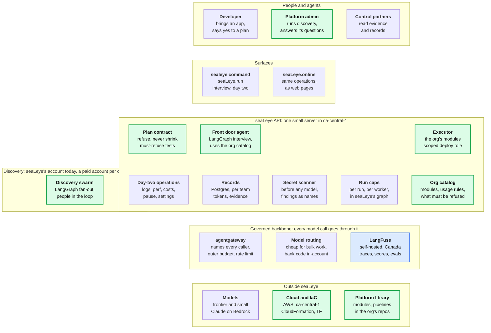

Key flow: one discovery run, overnight, in a new account for the customer; the run is paid. The swarm reads in parallel, asks people when unsure without ever waiting for them, and is tested before use. Built as drawn, but a person's answer is taken whenever it comes, never waited for (Q19); a run reads again only the modules that changed since the live catalog, unless asked to read them all.

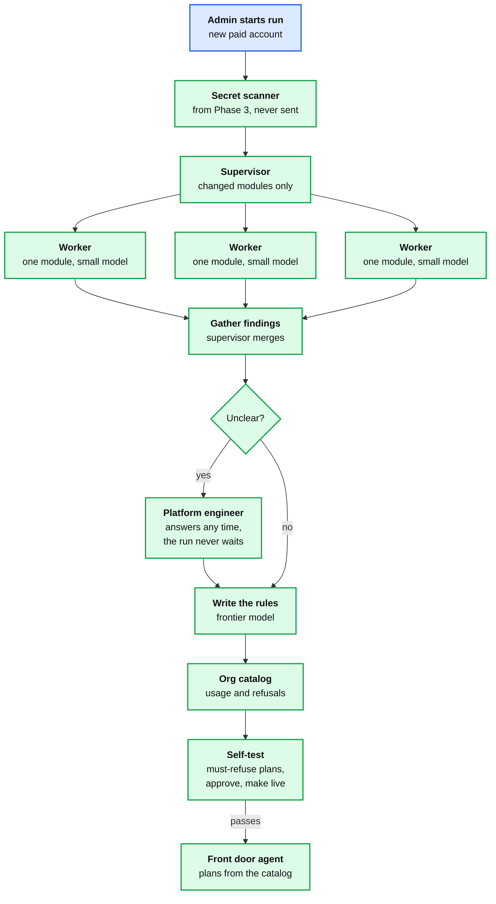

## Phase 5: The path to production

Phase 5 takes an app past dev, through the process the organization already runs. Promote asks; the change tool decides; then the stage is built and managed from then on, by seaLeye or by the organization's own pipeline, whichever the catalog says applies that stage (DESIGN.md, "seaLeye builds every stage, the way the organization chose for each"). An approval can wait for days, kept as a record a poller reads (PHASE5-PLAN D9 recommends this over a graph interrupt).

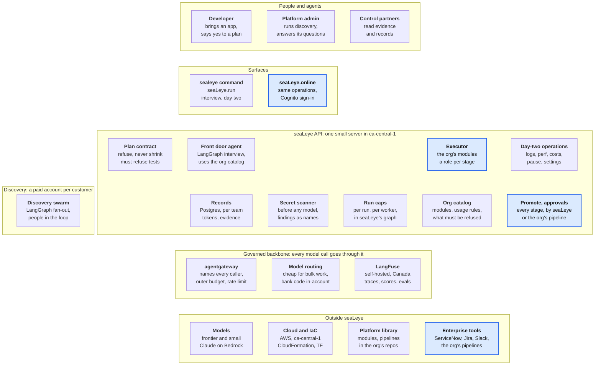

Key flow: one promotion, dev to the next stage. Promotion asks; the change process decides, even if it takes days; then whoever the catalog names for that stage builds it, and seaLeye reads its status back either way.

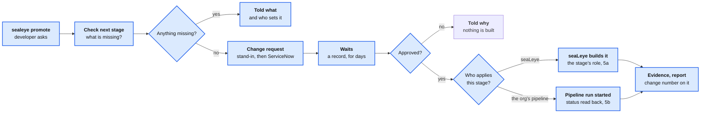

## Phase 6: seaLeye for agents

Phase 6 opens the same governed door to other agents. Agents get what developers get: the same tools, the same policy, the same evidence.

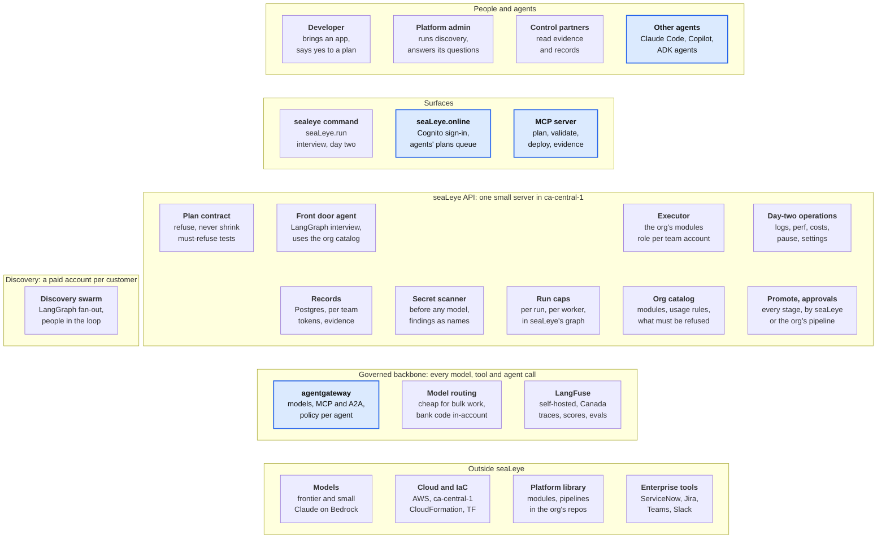

Key flow: a coding agent asks seaLeye for an environment through MCP. An agent gets exactly what a developer gets, and no more: its plan waits in a queue in the portal until a person on its team says yes.

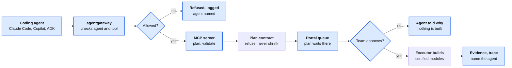

## Phase 7: Delivery and breadth

Phase 7 runs seaLeye inside the organization, on any cloud. Single tenant or in-network, on the organization's own model, with more clouds, regions and runtimes.

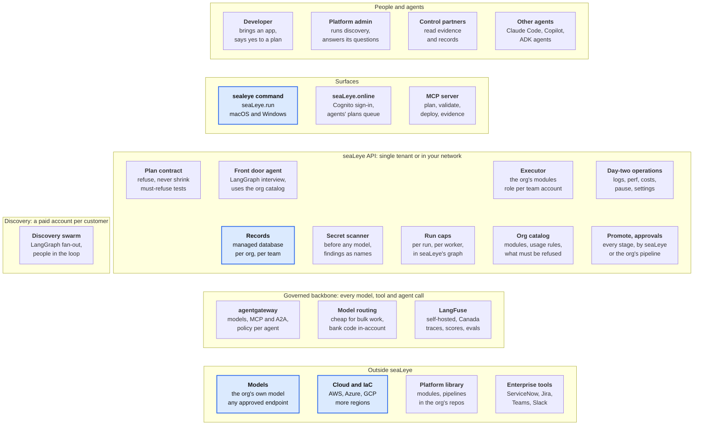

## Phase 8: seaLeye drafts modules

Phase 8 lets seaLeye draft the module that fills a gap the platform team chose. The picture is Phase 7's; one path changes, drawn here.

Key flow: a chosen gap becomes a module the platform team reviews. seaLeye proposes; a platform engineer decides.

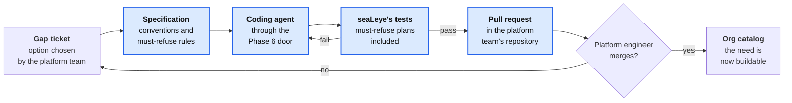
