# seaLeye: the build-out, phase by phase

First written Tue Oct 13, 2026, at 2.21.0. One picture per phase of [ROADMAP.md](ROADMAP.md),
all on the same layout, so a reader can flip between them and see what each phase adds,
and under it the one flow that shows the phase at work. Parts new or changed in a phase
are drawn in blue. [ARCHITECTURE.md](ARCHITECTURE.md)
describes the system as built today; this file describes where it is going. Why each
change is made lives in [DESIGN.md](../DESIGN.md), "The roadmap gains a governed backbone
and a door for agents".

When ROADMAP.md changes what a phase holds, fix its picture here in the same commit.

## The phases at a glance

| Phase | Name | State | What it adds |
|---|---|---|---|
| 0 | Foundation | Done Oct 8, 2026 | The demo becomes a product repo: cli, api and core, tests, CLAUDE.md, the roadmap |
| 1 | Team release | Mostly done Oct 11, 2026 | Hosted API, tokens, Postgres, the live portal, CI. Open: the second-person test |
| 2 | Day-two parity | Built Oct 12, 2026 | Logs, performance, costs, pause, configure, the settings store and evidence, on both surfaces |
| 3 | Governed backbone | **New**, next | agentgateway in front of every model call, routing, spend caps, LangFuse self-hosted in ca-central-1 |
| 4 | Learn the platform | Planned | A discovery swarm reads the organization's library into its catalog, with must-refuse tests and Terraform |
| 5 | The path to production | Planned | Promote, approvals in ServiceNow, Jira gap tickets, team accounts, Cognito sign-in |
| 6 | seaLeye for agents | **New**, planned | seaLeye's tools as MCP behind the gateway, for coding agents |
| 7 | Delivery and breadth | Planned | In-network or single tenant, the organization's own model, more clouds and regions, Windows |

Phases 3 and 6 were added on Oct 13, 2026; the old Phases 3, 4 and 5 became 4, 5 and 7.

## Today: Phases 0 to 2, as built (v2.21.0)

Today one agent builds only from four certified templates. Phases 0 to 2, v2.21.0, built Sept 20 to Oct 12, 2026. One agent, one model, every run traced.

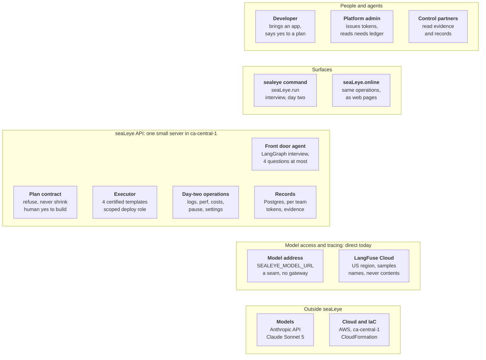

Key flow today: one `sealeye run`. A plan with needs is refused; only a ready plan is built. Every step is traced in LangFuse, file names but never contents.

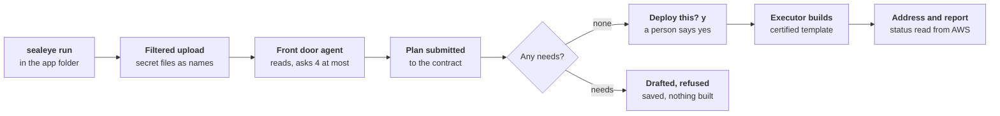

## Phase 3: Governed backbone

Phase 3 puts one governed door in front of every model call. Built before discovery, so the swarm runs on it from day one.

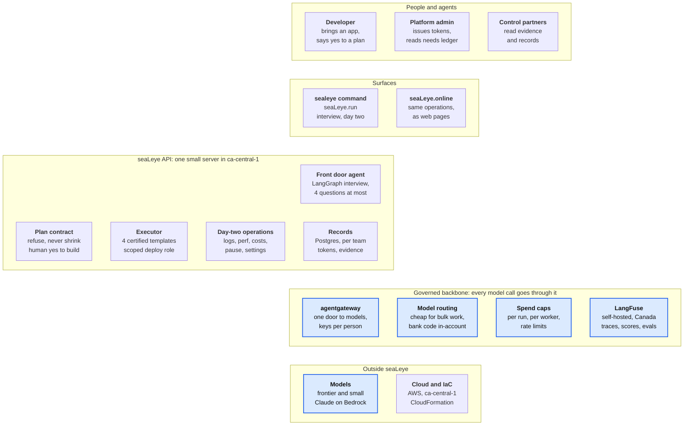

Key flow: one model call through the backbone. Every model call is identified, budgeted and routed before it leaves.

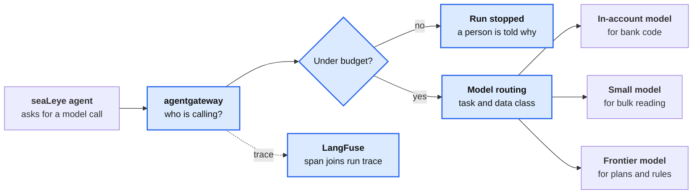

## Phase 4: Learn the platform

Phase 4 teaches seaLeye the platform the organization already has. A discovery swarm reads the library overnight; the front door agent then works from what it found.

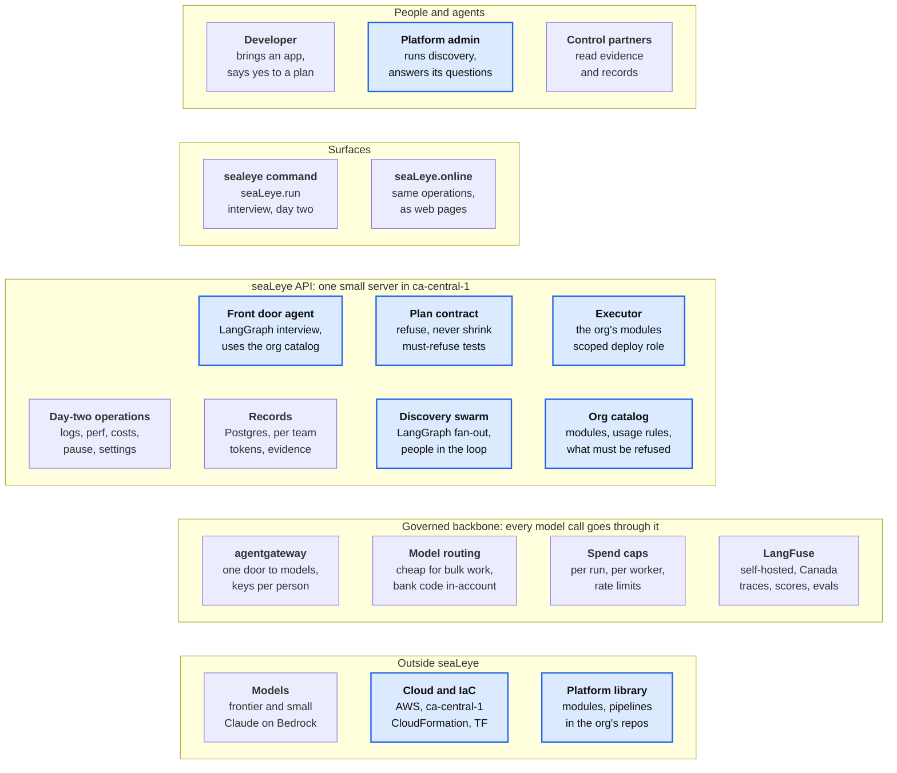

Key flow: one discovery run, overnight, in a new account for the customer; the run is paid. The swarm reads in parallel, asks people when unsure, and is tested before use.

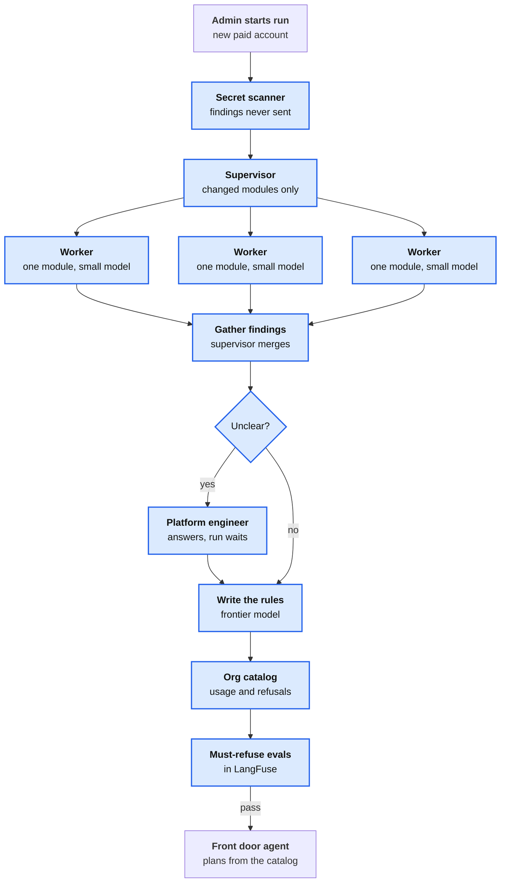

## Phase 5: The path to production

Phase 5 hands promotion to the process the organization already runs. Promote asks; the change tool decides. Approvals are graph interrupts that can wait for days.

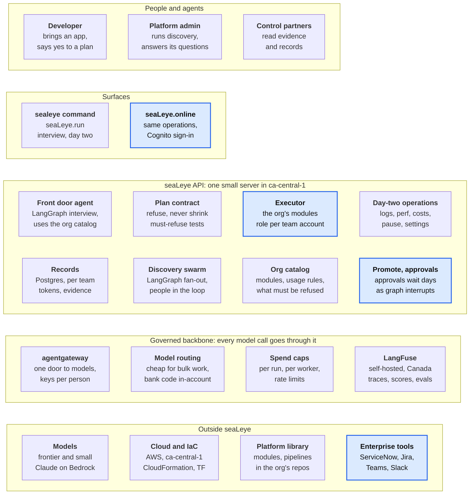

Key flow: one promotion, dev to the next stage. Promotion asks; the change process decides, even if it takes days. The graph waits as an interrupt while the change is reviewed.

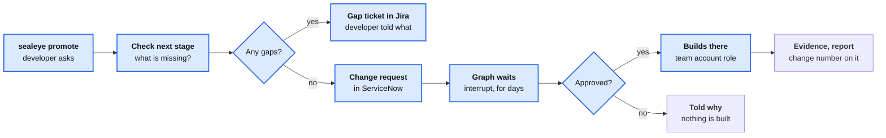

## Phase 6: seaLeye for agents

Phase 6 opens the same governed door to other agents. Agents get what developers get: the same tools, the same policy, the same evidence.

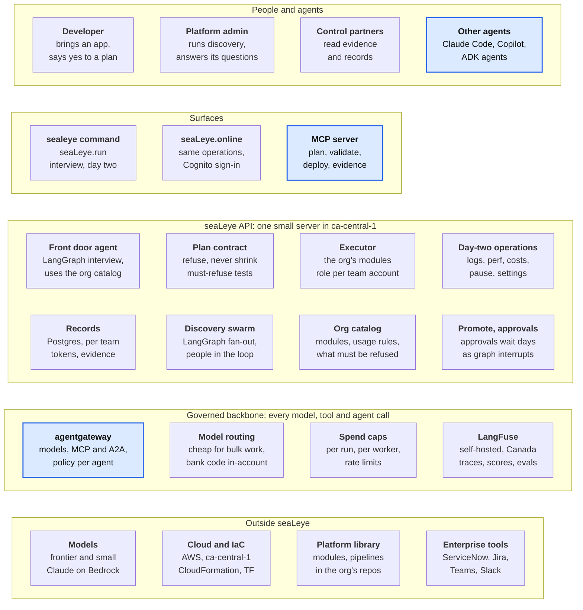

Key flow: a coding agent asks seaLeye for an environment through MCP. An agent gets exactly what a developer gets, and no more.

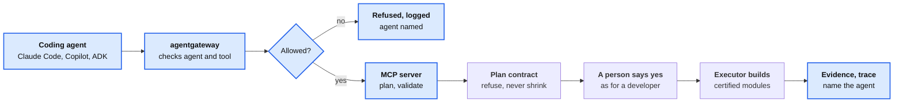

## Phase 7: Delivery and breadth

Phase 7 runs seaLeye inside the organization, on any cloud. Single tenant or in-network, on the organization's own model, with more clouds, regions and runtimes.

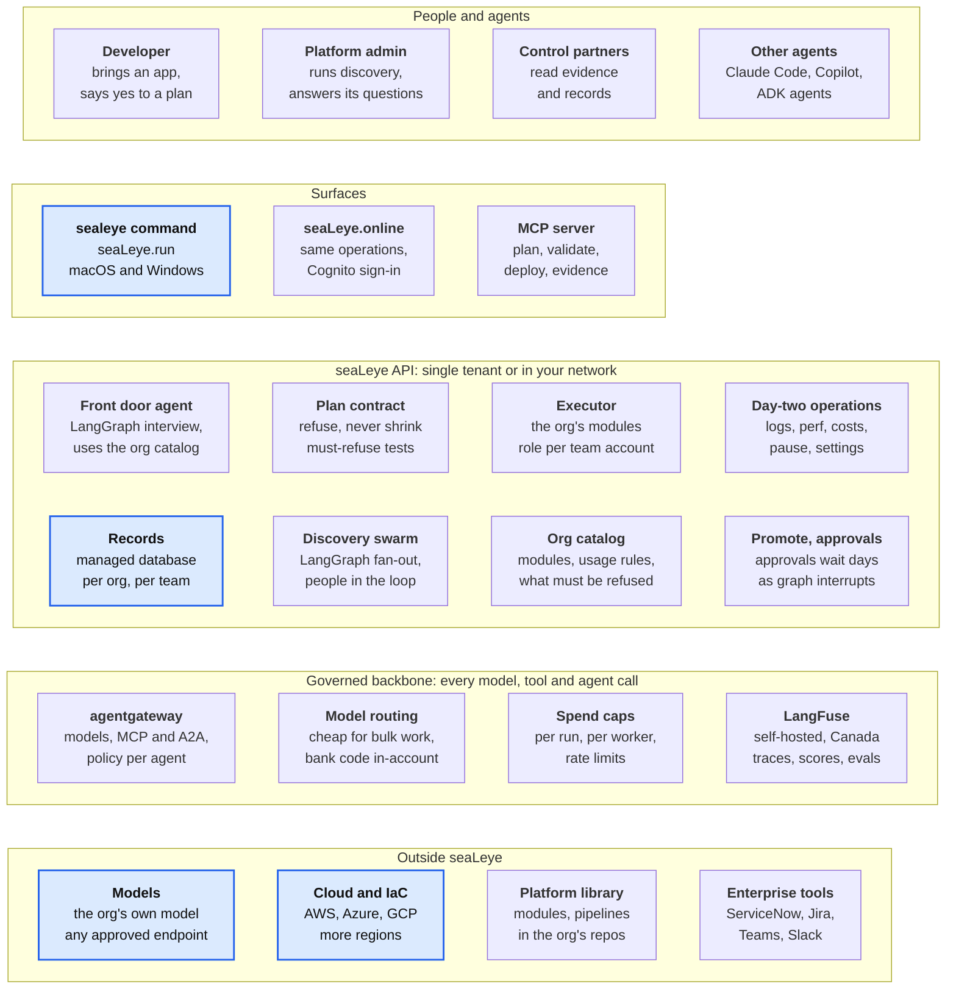
